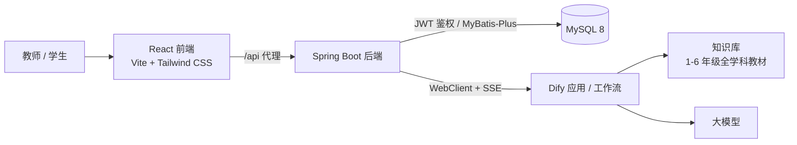

# AI 教师助手

[English](README.md) | 简体中文

面向小学教育的 AI 教学助手。项目由 React 前端、Spring Boot 后端与 Dify 工作流组成，提供**基于教材的问答**、**流式输出**与**可追溯的知识库引用**。

RAG 知识库覆盖**小学 1–6 年级全学科教材**，教师和学生可以按教材内容检索知识点、追问细节，并获得有教材依据的回答，而不是模型泛化知识。

## 核心特性

- **教材级 RAG**：回答由 Dify 知识库检索生成，知识库基于 1–6 年级全学科教材构建。
- **流式回答**：基于 SSE 增量输出，展示“正在检索知识库…”“正在生成回答…”等阶段提示。
- **引用可追溯**：知识库检索结果随回答一并展示，便于核对出处。
- **多轮会话**：支持会话列表、历史消息加载，并通过 `conversationId` 续接上下文。
- **JWT 鉴权**：无状态登录，提供 Access Token 与 Refresh Token。
- **容器化部署**：前后端独立镜像，配套 Jenkins 流水线。

## 整体架构



一次对话的请求链路：

1. 前端使用 `fetch` 调用 `GET /api/dify/chat-messages`（`EventSource` 无法携带 `Authorization` 请求头）。
2. 后端以 `streaming` 模式转发到 Dify 的 `chat-messages` 接口，并将 Dify 事件翻译为稳定的前端事件协议。
3. 前端以打字机效果渲染回答，并展示知识库检索结果作为引用。

## 技术栈

| 层次 | 技术 |
| --- | --- |
| 前端 | React 19、TypeScript、Vite 8、Tailwind CSS 4、Redux Toolkit、React Router 7、react-markdown + remark-gfm |
| 后端 | Spring Boot 4.1.1（Java 17）、Spring Security + JWT（JJWT）、Spring WebFlux（WebClient）、MyBatis-Plus 3.5.16、Lombok |
| 数据 | MySQL 8.0 |
| Agent / RAG | Dify 聊天应用 + 知识库检索节点 |
| 构建与运维 | Maven、npm、Docker、Nginx、Jenkins |

## 项目结构

```text
ai-teacher-assistant/
├── server/                       # Spring Boot 后端
│   ├── src/main/java/com/liuzane/aiteacherassistant/
│   │   ├── controller/           # Auth、User、Dify、Hello 接口
│   │   ├── service/              # Dify 对话、鉴权、用户服务
│   │   ├── filter/               # JwtAuthenticationFilter
│   │   ├── config/               # Spring Security 配置
│   │   ├── model/                # 实体、DTO、VO
│   │   └── utils/                # JwtUtil
│   ├── src/main/resources/       # application.yaml、application-dev/prod.yaml
│   ├── sql/user.sql              # 初始化表结构与种子用户
│   └── Dockerfile
├── web/                          # React 前端
│   ├── src/api/                  # chat、conversation、user、hello
│   ├── src/pages/                # login、chat（头部/列表/输入/消息）
│   ├── src/store/                # Redux Toolkit 状态管理
│   ├── nginx.conf                # 生产环境 Nginx 模板
│   └── Dockerfile
└── Jenkinsfile                   # 构建与部署流水线
```

## 快速开始

### 环境要求

- JDK 17+
- Node.js 24+、npm 11+
- MySQL 8.0+
- 已部署并发布可用的 Dify 聊天应用与教材知识库

### 1. 初始化数据库

```bash
mysql -u root -p -e "CREATE DATABASE IF NOT EXISTS ai_teacher_assistant DEFAULT CHARSET utf8mb4;"
mysql -u root -p ai_teacher_assistant < server/sql/user.sql
```

脚本会创建 `user` 表，并写入 `admin / admin` 测试账号。

### 2. 配置后端

`server/src/main/resources/application.yaml` 定义了端口（`8080`）并默认启用 `dev` profile。`application-dev.yaml` 与 `application-prod.yaml` 均从 Spring Cloud Config Server 导入配置（使用 `optional:`，配置中心不可用时也能启动）。

请通过配置中心（推荐）或本地 profile 提供以下配置：

```yaml
dify:
  api:
    url: http://<dify-host>:5001/v1    # Dify API 地址
    key: app-xxxxxxxxxxxxxxxx          # Dify 应用 API Key
```

MySQL 数据源、JWT 密钥等环境相关配置也应从同一配置源加载，请勿将真实密钥提交到仓库。

### 3. 启动后端

```bash
cd server
./mvnw spring-boot:run
```

服务默认以 `dev` profile 在 `http://localhost:8080` 启动，可通过 `SPRING_PROFILES_ACTIVE=prod` 切换环境。

### 4. 启动前端

```bash
cd web
npm install
npm run dev
```

开发服务器运行在 `http://localhost:3000`，并将 `/api` 代理到 `http://localhost:8080`。

打开页面，使用 `admin / 123456` 登录即可开始对话。

## 配置说明

### 前端环境变量

| 变量 | 所在文件 | 默认值 | 说明 |
| --- | --- | --- | --- |
| `VITE_PORT` | `.env.development` | `3000` | 开发服务器端口 |
| `VITE_SERVER_ORIGIN` | `.env.development` | `http://localhost:8080` | 开发代理的后端地址 |
| `VITE_API_PREFIX` | `.env` | `/api` | 开发代理中需要去除的接口前缀 |
| `VITE_API_BASE_URL` | 可选 | `/api` | 聊天 SSE 请求使用的基础路径 |

### 后端关键配置

| 配置项 | 说明 |
| --- | --- |
| `server.port` | HTTP 端口，默认 `8080` |
| `spring.profiles.active` | 默认 `dev`；生产环境设置 `SPRING_PROFILES_ACTIVE=prod` |
| `spring.config.import` | 可选的配置中心导入地址 |
| `dify.api.url` | Dify API 基础地址 |
| `dify.api.key` | Dify 应用 API Key |

## 接口一览

除 `/auth/login`、`/auth/refresh`、`/error` 外，所有接口都需要携带 `Authorization: Bearer <accessToken>`。浏览器实际访问时使用 `/api` 前缀，由 Vite 开发代理或生产环境的 Nginx 去除。

| 方法 | 路径 | 说明 |
| --- | --- | --- |
| `POST` | `/auth/login` | 登录，返回 Access Token 与 Refresh Token |
| `POST` | `/auth/refresh` | 使用 Refresh Token 换取新的 Access Token |
| `GET` | `/user/info` | 当前用户信息 |
| `GET` | `/hello/teacher` | 连通性检查用的问候接口 |
| `GET` | `/dify/chat-messages` | 流式对话（`text/event-stream`），参数：`query`、`userId`、`conversationId?` |
| `GET` | `/dify/conversations` | 会话列表，参数：`userId`、`lastId?`、`limit=20`、`sortBy=-updated_at` |
| `GET` | `/dify/messages` | 历史消息，参数：`conversationId`、`userId?`、`firstId?`、`limit=20` |

### 流式事件协议

后端将 Dify 事件统一为以下类型，每条 SSE `data:` 帧为纯 JSON：

| 事件类型 | 含义 |
| --- | --- |
| `WORKFLOW_STARTED` | 工作流开始，携带 `conversationId`、`messageId` |
| `KNOWLEDGE_RETRIEVAL_STARTED` | 知识库检索开始 |
| `KNOWLEDGE_RETRIEVAL_FINISHED` | 知识库检索完成，携带 `result`（前端作为引用展示） |
| `TEXT_STARTED` | 大模型节点开始 |
| `TEXT_FINISHED` | 大模型节点完成，携带该节点的完整 `text` |
| `MESSAGE` | 回答文本增量 |
| `WORKFLOW_FINISHED` | 工作流结束；`[DONE]` 也会映射为该事件 |
| `HEARTBEAT` | 流空闲超过一分钟时推送，避免网关因长时间无数据而断流 |

前端会忽略 `HEARTBEAT`，仅依赖其他事件类型更新回答内容。

## 知识库与 RAG

Dify 应用建议按以下流程编排：

1. 接收用户问题，并带入会话上下文。
2. 通过知识库检索节点查询教材知识库（1–6 年级全学科）。
3. 基于检索到的文本片段生成回答，并保留引用元信息。
4. 流式返回结果；后端将检索结果作为 `KNOWLEDGE_RETRIEVAL_FINISHED` 下发，前端据此展示回答依据。

知识库构建建议：

- 按教材分册建立文档，并补充年级、学科、册次等元数据。
- 清理 OCR 噪声，保留标题层级，保证切片语义完整。
- 统一切片长度与重叠比例；教材修订后及时重建索引。

## 部署

### 构建镜像

```bash
# 后端（构建上下文为 server/，Dockerfile 复制 Maven 产物）
cd server && ./mvnw -B -DskipTests clean package && cd ..
docker build -t ai-teacher-assistant-server:latest -f server/Dockerfile server/

# 前端（先构建，再复制 dist/ 与 nginx.conf）
cd web && npm ci && npm run build && cd ..
docker build -t ai-teacher-assistant-web:latest -f web/Dockerfile web/
```

### 运行容器

```bash
docker run -d --name ai-teacher-assistant-server \
  -p 8080:8080 \
  -e SPRING_PROFILES_ACTIVE=prod \
  -e JAVA_OPTS="-Xms256m -Xmx512m" \
  ai-teacher-assistant-server:latest

docker run -d --name ai-teacher-assistant-web \
  -p 80:80 \
  -e BACKEND_ORIGIN=http://ai-teacher-assistant-server:8080 \
  ai-teacher-assistant-web:latest
```

前端镜像通过 Nginx 提供静态资源：客户端路由回退到 `index.html`，`/api/` 反向代理到后端，并针对 SSE 关闭缓冲、放宽超时。

### Jenkins

`Jenkinsfile` 依次完成前端构建、后端 Maven 打包、前后端镜像构建，并重启现有容器。所需工具：`NodeJS-24`、`JDK-17`、`Maven-3.9.16`。

## 参与贡献

欢迎提交 Issue 与 Pull Request。请保持改动聚焦、遵循现有代码风格，并避免提交密钥或不可再分发的教材文件。

## 许可证

项目尚未声明开源许可证，商业使用前请联系仓库所有者。
