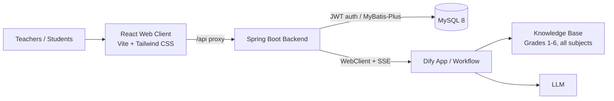

# AI Teacher Assistant

English | [简体中文](README-zh.md)

An AI teaching assistant for primary school education. It combines a React web client, a Spring Boot backend, and a Dify workflow to deliver **textbook-grounded Q&A with streaming answers** and **traceable knowledge-base citations**.

The RAG knowledge base covers **Grades 1–6 of primary school across all subjects**, so teachers and students can look up textbook content, ask follow-up questions, and get answers anchored in official teaching materials instead of general model knowledge.

## Highlights

- **Textbook-based RAG** — answers are retrieved from a Dify knowledge base built from Grades 1–6, all-subject textbooks.
- **Streaming answers** — SSE-based incremental output, with stage hints such as "retrieving knowledge base…" and "generating answer…".
- **Citation display** — knowledge-retrieval results are surfaced alongside the answer for verification.
- **Multi-turn conversations** — conversation list, history loading, and conversation resume by `conversationId`.
- **JWT authentication** — stateless login with access/refresh tokens.
- **Containerized deployment** — separate Docker images for frontend and backend, plus a Jenkins pipeline.

## Architecture



Request flow for a chat message:

1. The web client calls `GET /api/dify/chat-messages` with `fetch`, because `EventSource` cannot carry the `Authorization` header.
2. The backend forwards the request to the Dify `chat-messages` API in `streaming` mode and translates Dify events into a stable, frontend-friendly event protocol.
3. The frontend renders the answer with a typewriter effect and displays knowledge-retrieval results as sources.

## Tech Stack

| Layer | Technologies |
| --- | --- |
| Frontend | React 19, TypeScript, Vite 8, Tailwind CSS 4, Redux Toolkit, React Router 7, react-markdown + remark-gfm |
| Backend | Spring Boot 4.1.1 (Java 17), Spring Security + JWT (JJWT), Spring WebFlux (WebClient), MyBatis-Plus 3.5.16, Lombok |
| Data | MySQL 8.0 |
| Agent / RAG | Dify chat application with knowledge retrieval |
| Build & Ops | Maven, npm, Docker, Nginx, Jenkins |

## Project Structure

```text
ai-teacher-assistant/
├── server/                       # Spring Boot backend
│   ├── src/main/java/com/liuzane/aiteacherassistant/
│   │   ├── controller/           # Auth, User, Dify, Hello endpoints
│   │   ├── service/              # Dify chat/conversation, auth, user
│   │   ├── filter/               # JwtAuthenticationFilter
│   │   ├── config/               # Spring Security configuration
│   │   ├── model/                # Entities, DTOs, VOs
│   │   └── utils/                # JwtUtil
│   ├── src/main/resources/       # application.yaml, application-dev/prod.yaml
│   ├── sql/user.sql              # Initial schema and seed user
│   └── Dockerfile
├── web/                          # React frontend
│   ├── src/api/                  # chat, conversation, user, hello
│   ├── src/pages/                # login, chat (header/list/sender/messages)
│   ├── src/store/                # Redux Toolkit store
│   ├── nginx.conf                # Production Nginx template
│   └── Dockerfile
└── Jenkinsfile                   # Build and deploy pipeline
```

## Quick Start

### Prerequisites

- JDK 17+
- Node.js 24+ and npm 11+
- MySQL 8.0+
- A running Dify instance with a published chat app and a textbook knowledge base

### 1. Prepare the database

```bash
mysql -u root -p -e "CREATE DATABASE IF NOT EXISTS ai_teacher_assistant DEFAULT CHARSET utf8mb4;"
mysql -u root -p ai_teacher_assistant < server/sql/user.sql
```

The seed script creates the `user` table and an `admin / 123456` account.

### 2. Configure the backend

`server/src/main/resources/application.yaml` sets the port (`8080`) and activates the `dev` profile by default. Both `application-dev.yaml` and `application-prod.yaml` import configuration from a Spring Cloud Config Server (`optional:`, so startup is not blocked when it is unavailable).

Provide the following properties through your Config Server (recommended) or your local profile:

```yaml
dify:
  api:
    url: http://<dify-host>:5001/v1    # Dify API base URL
    key: app-xxxxxxxxxxxxxxxx          # Dify app API key
```

The MySQL datasource, JWT secret, and other environment-specific values should also come from the same configuration source. Never commit real API keys or secrets.

### 3. Start the backend

```bash
cd server
./mvnw spring-boot:run
```

The service starts at `http://localhost:8080` with the `dev` profile. Override with `SPRING_PROFILES_ACTIVE=prod` when needed.

### 4. Start the frontend

```bash
cd web
npm install
npm run dev
```

The dev server runs at `http://localhost:3000` and proxies `/api` to `http://localhost:8080`.

Open the app, sign in with `admin / 123456`, and start chatting.

## Configuration

### Frontend environment variables

| Variable | File | Default | Description |
| --- | --- | --- | --- |
| `VITE_PORT` | `.env.development` | `3000` | Dev server port |
| `VITE_SERVER_ORIGIN` | `.env.development` | `http://localhost:8080` | Backend origin used by the dev proxy |
| `VITE_API_PREFIX` | `.env` | `/api` | API path prefix stripped by the dev proxy |
| `VITE_API_BASE_URL` | optional | `/api` | Base URL used by the chat SSE request |

### Backend key properties

| Property | Description |
| --- | --- |
| `server.port` | HTTP port, `8080` by default |
| `spring.profiles.active` | `dev` by default; set `SPRING_PROFILES_ACTIVE=prod` for production |
| `spring.config.import` | Optional Config Server import |
| `dify.api.url` | Dify API base URL |
| `dify.api.key` | Dify application API key |

## API Reference

All endpoints except `/auth/login`, `/auth/refresh`, and `/error` require `Authorization: Bearer <accessToken>`. In the browser these paths are reached under the `/api` prefix, which is stripped by the Vite dev proxy or by Nginx in production.

| Method | Path | Description |
| --- | --- | --- |
| `POST` | `/auth/login` | Sign in, returns access and refresh tokens |
| `POST` | `/auth/refresh` | Exchange a refresh token for a new access token |
| `GET` | `/user/info` | Current user profile |
| `GET` | `/hello/teacher` | Greeting endpoint used for connectivity checks |
| `GET` | `/dify/chat-messages` | Streaming chat (`text/event-stream`), params: `query`, `userId`, `conversationId?` |
| `GET` | `/dify/conversations` | Conversation list, params: `userId`, `lastId?`, `limit=20`, `sortBy=-updated_at` |
| `GET` | `/dify/messages` | Conversation history, params: `conversationId`, `userId?`, `firstId?`, `limit=20` |

### Streaming event protocol

The backend normalizes Dify events; each SSE `data:` frame contains a plain JSON object with a `type` field:

| Event type | Meaning |
| --- | --- |
| `WORKFLOW_STARTED` | Workflow started; carries `conversationId` and `messageId` |
| `KNOWLEDGE_RETRIEVAL_STARTED` | Knowledge retrieval started |
| `KNOWLEDGE_RETRIEVAL_FINISHED` | Retrieval finished; carries `result` (used as sources) |
| `TEXT_STARTED` | LLM node started |
| `TEXT_FINISHED` | LLM node finished; carries the node's full `text` |
| `MESSAGE` | Incremental answer text |
| `WORKFLOW_FINISHED` | Workflow ended; `[DONE]` is also mapped to this event |
| `HEARTBEAT` | Emitted when the stream has been idle for one minute, preventing gateways from closing long-running connections |

The frontend ignores `HEARTBEAT` and relies on the other event types to update the answer.

## Knowledge Base and RAG

The Dify application is expected to follow this flow:

1. Receive the user question with conversation context.
2. Run a knowledge-retrieval node against the textbook knowledge base (Grades 1–6, all subjects).
3. Generate the answer with the retrieved chunks, keeping the citation metadata intact.
4. Stream tokens back; the backend forwards retrieval results as `KNOWLEDGE_RETRIEVAL_FINISHED` so the UI can show which textbook content the answer is based on.

Tips for a good knowledge base:

- Keep one document per textbook volume and tag metadata such as grade, subject, and volume.
- Clean OCR noise and preserve headings, so retrieval chunks stay coherent.
- Use consistent chunk sizes and overlap; re-index after textbook revisions.

## Deployment

### Docker images

```bash
# Backend (context is server/, the Dockerfile copies the Maven artifact)
cd server && ./mvnw -B -DskipTests clean package && cd ..
docker build -t ai-teacher-assistant-server:latest -f server/Dockerfile server/

# Frontend (build first, then copy dist/ and nginx.conf)
cd web && npm ci && npm run build && cd ..
docker build -t ai-teacher-assistant-web:latest -f web/Dockerfile web/
```

### Run containers

```bash
docker run -d --name ai-teacher-assistant-server \
  -p 8080:8080 \
  -e SPRING_PROFILES_ACTIVE=prod \
  -e JAVA_OPTS="-Xms256m -Xmx512m" \
  ai-teacher-assistant-server:latest

docker run -d --name ai-teacher-assistant-web \
  -p 80:80 \
  -e BACKEND_ORIGIN=http://ai-teacher-assistant-server:8080 \
  ai-teacher-assistant-web:latest
```

The frontend image serves static files through Nginx, falls back to `index.html` for client-side routes, proxies `/api/` to the backend, and disables buffering for SSE responses.

### Jenkins

`Jenkinsfile` builds the frontend, packages the backend, builds both Docker images, and restarts the existing containers. Tool requirements: `NodeJS-24`, `JDK-17`, `Maven-3.9.16`.

## Contributing

Issues and pull requests are welcome. Please keep changes focused, follow the existing code style, and avoid committing credentials or textbook files that cannot be redistributed.

## License

No license has been declared yet. Contact the repository owner before commercial use.
